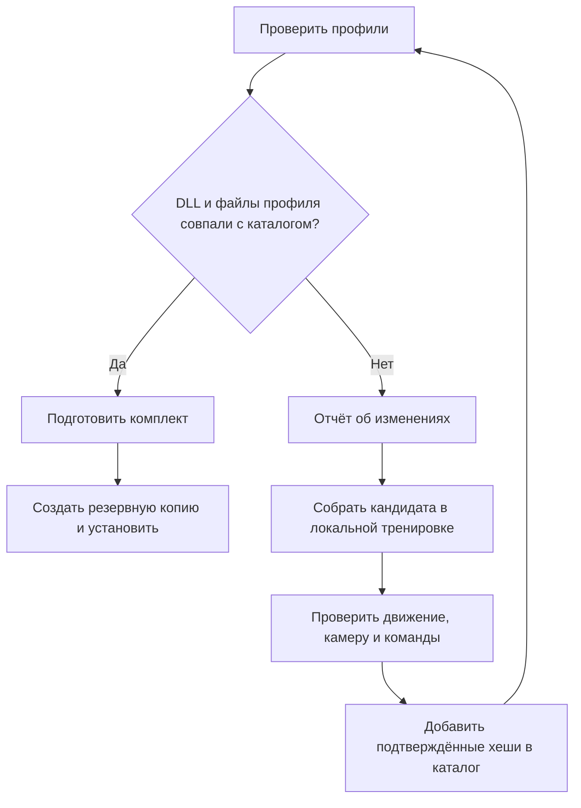

# CS2Panel

**Панель управления клиентами Counter-Strike 2 для Windows**

[Сборка](#build) · [После патча CS2](#updates) · [Совместимость](#platform) · [Карты](#maps)

   

CS2Panel — панель для Windows, которая показывает запущенные клиенты Counter-Strike 2, позволяет переключаться между ними и запускать навигатор для выбранного процесса. Интерфейс написан на Qt Quick/QML. Панель и навигатор используют один исполняемый файл. Экземпляр навигатора привязывается к PID и времени создания процесса.

## Что входит

- **Панель** (`multibox/`). Карточки окружений, настройки, темы, диагностика Steam, Sandboxie и GSI. Sandboxie-Plus нужен для запуска отдельных окружений.
- **Навигатор** (`cpp/`). Чтение состояния, планирование пути по навигационной сетке, обнаружение застревания, управление движением и боем. Часть функций зависит от конкретной сборки игры: код читает и изменяет память процесса и использует выполнение команд внутри клиента. GSI служит отдельным источником данных.
- **Профили совместимости** (`tools/compatibility/`). Обновлятор сверяет версию и хеши файлов игры с локальным каталогом, готовит комплект и сохраняет резервную копию при установке. Новый кандидат требует проверки на клиенте.
- В корне сохранён ранний Python-прототип распознавания радара. Для запуска C++-панели устанавливать его зависимости не требуется.

<a id="build"></a>

## Сборка и запуск на Windows x64

Понадобятся Visual Studio 2022 Build Tools с компонентом «Разработка классических приложений на C++», Windows SDK, CMake 3.25 или новее, Ninja, Python 3 и Qt 6.8 или новее для MSVC x64 с модулями QML, Quick и Quick Controls. Выполняйте команды из корня клона в PowerShell. Укажите свой каталог Qt, содержащий `lib/cmake/Qt6/Qt6Config.cmake`.

```powershell
$qt = 'C:\Qt\6.8.3\msvc2022_64'
.\multibox\build-quick.ps1 -QtRoot $qt -BuildDirectory build-public
$env:PATH = "$qt\bin;$env:PATH"
.\multibox\build-public\CS2Panel.exe
```

Скрипт собирает встроенный навигатор вместе с панелью и запускает тесты панели. Для отдельной сборки ядра и его тестов:

```powershell
.\cpp\build.ps1 -BuildDirectory build-public
python -m unittest discover -s tools/compatibility -p 'test_*.py'
```

## Примеры

1. **Проверить интерфейс без запуска игры.** Откройте панель. Выберите карточку окружения, откройте «Информация» или диагностику. Для нового окружения задайте имя в панели. Данные учётной записи вводятся в Steam.
2. **Проверить совместимость с установленной CS2.** Следующая команда создаёт отчёт в новом каталоге. Код выхода 0 означает, что комплект соответствует локальному каталогу, 2 — что требуется проверка, 1 — ошибку выполнения.

```powershell
$game = 'C:\Program Files (x86)\Steam\steamapps\common\Counter-Strike Global Offensive'
$out = 'compat-report-' + [guid]::NewGuid().ToString('N')
python tools/compatibility/update.py prepare --game $game --assets cpp/assets --output $out
```

3. **Проверить навигатор в локальной тренировке.** Подготовьте GSI для выбранного окружения через панель, запустите тренировку в CS2, выберите карточку соответствующего процесса и подключите навигатор. Для движения нужны файлы маршрутов и геометрии выбранной карты.

<a id="platform"></a>

## Совместимость

| Как запускать | Проверенная конфигурация |
| --- | --- |
| Два клиента | Windows 10 Pro 19045.6466 и Sandboxie-Plus 1.12.9. Для второго Steam нужны отдельное окружение и аккаунт. |
| Один клиент | Основной Steam. Для одного клиента песочница не нужна. |
| Другая Windows или Sandboxie | Рассчитывайте на один клиент. Многоклиентный режим в этой конфигурации не подтверждён. |

<a id="maps"></a>

## Карты

В обычный клон включены **Dust II, Mirage, Inferno, Vertigo и Cache**. Для каждой карты в [cpp/assets](cpp/assets) лежат навигационная сетка (`.nav.json`) и геометрия видимости (`.mesh`). При сборке панели CMake копирует их в `bot/assets/` рядом с EXE. Скачивать карты отдельно не нужно.

Источник геометрии — [awpy-data, выпуск 2000933](https://github.com/pnxenopoulos/awpy-data/releases/tag/2000933). Номер геометрии и версия профиля памяти обновляются независимо. После изменения планировки маршруты нужно проверить заново.

> [!NOTE]
> Автозапуск Deathmatch через меню требует локальных шаблонов в `cpp/assets/network-menu/`. В публичной сборке матч можно открыть вручную.

<a id="updates"></a>

## Обновлятор профилей · «Мемориконтузия»

После патча CS2 адреса игровых данных могут сместиться. Обновлятор проверяет конкретные файлы `client.dll` и `engine2.dll` и помогает восстановить три профиля, от которых зависит навигатор.

| Файл | За что отвечает |
| --- | --- |
| `memory.json` | Чтение состояния игрока и положения камеры |
| `input-buttons.json` | Привязки кнопок для фонового управления |
| `game-commands.json` | Проверка интерфейса движка для игровых команд |



**Как это прошло на версии 2000940.** При переходе с 2000938 обновлятор дважды собрал одинаковые профили в разных процессах CS2. В тренировке персонаж прошёл 207 игровых единиц, камера повернулась по обеим осям, а команды переключили Desert Eagle и АК-47 в фоне. Автоматическая закупка в этой проверке осталась неподтверждённой.

### Действия после патча

1. Нажмите **«Проверить профили»** в панели или выполните команду `prepare` из примера выше. Обновлятор проверит версию и отпечатки DLL.
2. Если комплект известен, закройте панель, навигаторы и CS2. Установите проверенные профили командой ниже. Установщик создаст резервную копию.

   ```powershell
   python tools/compatibility/update.py install --package $out --target multibox/build-public/bot/assets
   ```

3. Если код выхода равен 2, откройте `report.json` в каталоге отчёта. Для неизвестной DLL требуется собрать кандидата на запущенном клиенте (параметры `--runtime-pid` и `--runtime-created`, время создания процесса в формате Windows FILETIME), проверить движение, камеру и команды в тренировке и внести подтверждённые хеши в каталог. Сам сбор кандидата не разрешает его установку.

<details>
<summary><strong>Что делать, если установка прервалась?</strong></summary>

Если обновлятор сообщает о незавершённой транзакции, закройте панель и CS2. Для каталога из примера выше выполните:

```powershell
python tools/compatibility/update.py recover --target multibox/build-public/bot/assets
```

Команда проверяет блокировку и журнал установки и при необходимости восстанавливает прежние файлы из резервной копии. После восстановления повторите проверку профилей.

</details>

[Исходники обновлятора и регрессионные тесты](tools/compatibility/)
